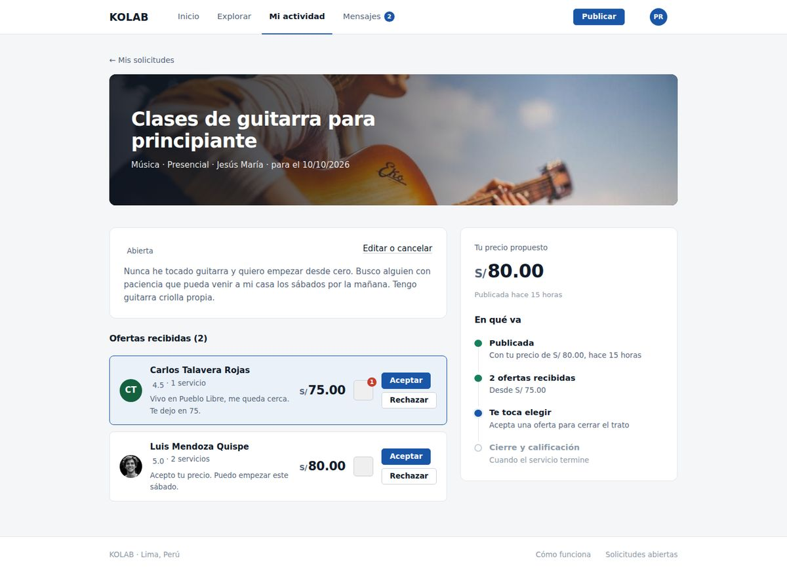
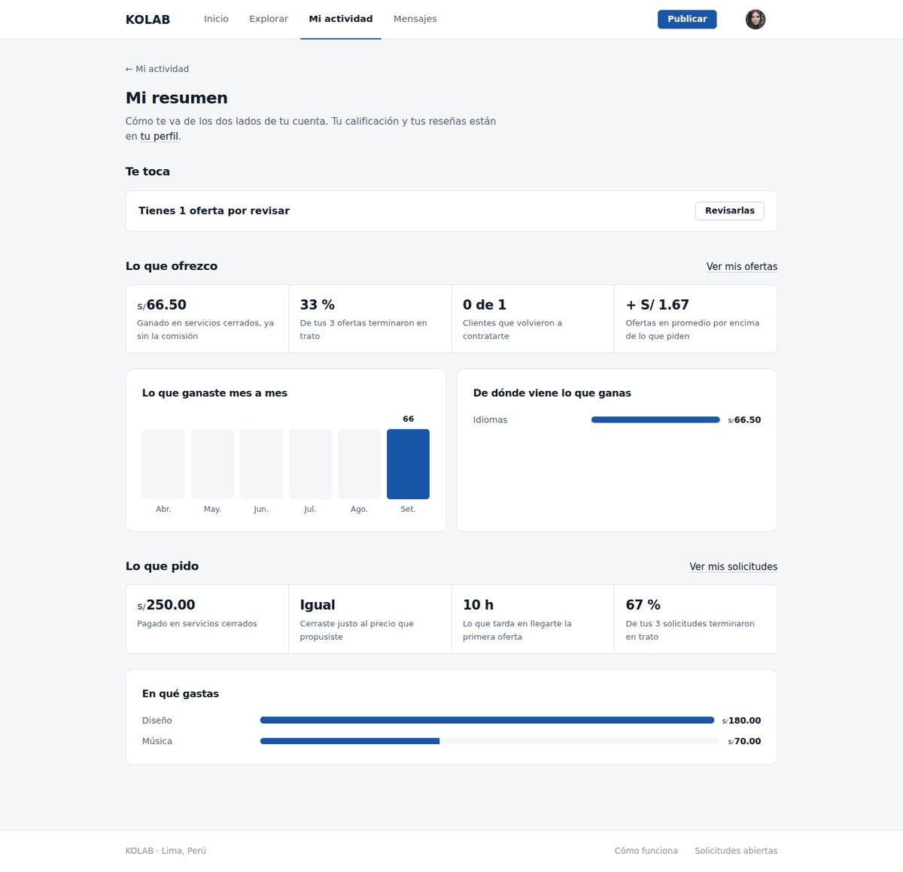

# KOLAB

Plataforma para intercambiar habilidades y servicios en la que quien pide pone el precio: publicas
lo que necesitas con el monto que quieres pagar, y quien sabe hacerlo lo acepta o te propone otro.
Una misma cuenta sirve para pedir y para ofrecer.

Proyecto del curso Integrador I: Sistemas - Software, Universidad Tecnológica del Perú, 2026.

## Equipo

| Integrante | Rol | GitHub |
|---|---|---|
| Marco Antonio Campos Llanos | Director del proyecto | [@marcocll159-bot](https://github.com/marcocll159-bot) |
| Paolo Rodríguez Paredes | Líder técnico y responsable del repositorio | [@paolo2711](https://github.com/paolo2711) |
| Erick Alexander Marcos Laupa | Requisitos y desarrollo | [@erickmarcoslaupa-lgtm](https://github.com/erickmarcoslaupa-lgtm) |
| Walter Huete Castillo | Interfaz y experiencia de usuario | [@huetecastillowalter-cloud](https://github.com/huetecastillowalter-cloud) |
| Juan Enrique Carhuallanqui Osorio | Base de datos y pruebas | [@JuanCOutp](https://github.com/JuanCOutp) |

## Capturas

Portada, para quien todavía no tiene cuenta:

Inicio con sesión:

Una solicitud con las ofertas que recibió:

Perfil público de quien ofrece:

Mi resumen, de alguien que pide y también ofrece:

## Requisitos

- JDK 21 o superior (https://adoptium.net).
- PostgreSQL 16 o superior, con el instalador de Windows (https://www.postgresql.org/download/windows/).
  Durante la instalación te pide una clave para el usuario `postgres`: anótala.

Maven no hace falta, el wrapper va incluido.

## Instalar, una sola vez

1. Doble clic en `instalar-base.cmd`, en la raíz del proyecto. Te propone el puerto de tu PostgreSQL
   (Enter para aceptarlo) y te pide la clave de `postgres`. Crea la base `kolab` y deja guardado lo
   que la aplicación necesita para conectarse. Si la base ya existía, te pide confirmar y la crea
   de cero.
2. Cierra VS Code y vuelve a abrirlo. Sin esto no ve lo que dejó el paso anterior.

## Ejecutar

En VS Code, con la extensión Extension Pack for Java, abre la carpeta del proyecto y dale Run a
`src/main/java/com/kolab/KolabApplication.java`. Después abre http://localhost:8080.

La primera vez la base se llena sola con datos de ejemplo.

## Cuentas de ejemplo

    cliente@kolab.pe / kolab1234
    experto@kolab.pe / kolab1234

Todas las personas de `src/main/resources/ejemplos/personas.json` entran con `kolab1234`.

## Mientras se desarrolla

Al pie de la pantalla de ingreso están las cuentas de ejemplo y dos enlaces:

- reiniciar datos: borra todo y vuelve a cargar los ejemplos. Sirve cuando cambias un JSON de
  `ejemplos` o cuando la base quedó desordenada.
- cargar ejemplos: los carga solo si la base está vacía.

Para recuperar una contraseña todavía no hay correo: después de poner tu correo, la misma pantalla
muestra el enlace para cambiarla.

Nada de esto existe en el servidor. Depende de `KOLAB_DESARROLLO`, que solo deja puesto
`instalar-base.cmd`.

## Pruebas

    mvnw.cmd -B test

Corren contra H2 en memoria con las mismas migraciones, así que no necesitan PostgreSQL.

## Stack

Java 21, Spring Boot 3.5, Thymeleaf, Spring Security, Spring Data JPA, PostgreSQL, Flyway y Maven.
CSS propio.

## Cómo trabaja el equipo

Ramas:

    main                versiones publicadas, con su etiqueta
    develop             lo que ya está terminado y se integra
    feature/<tarea>     una por Issue, sale de develop
    release/<versión>   para cerrar una versión

Nadie sube directo a `main` ni a `develop`. Cada tarea es un Issue, su rama sale de `develop` y
vuelve por Pull Request con al menos una aprobación. Las fusiones se hacen con commit de fusión,
para que el historial muestre qué entró junto.

Las pruebas corren solas en cada Pull Request (`.github/workflows/pruebas.yml`); si fallan, no se
fusiona.

Las versiones siguen el versionado semántico y cada una se anota en
[CHANGELOG.md](CHANGELOG.md).
